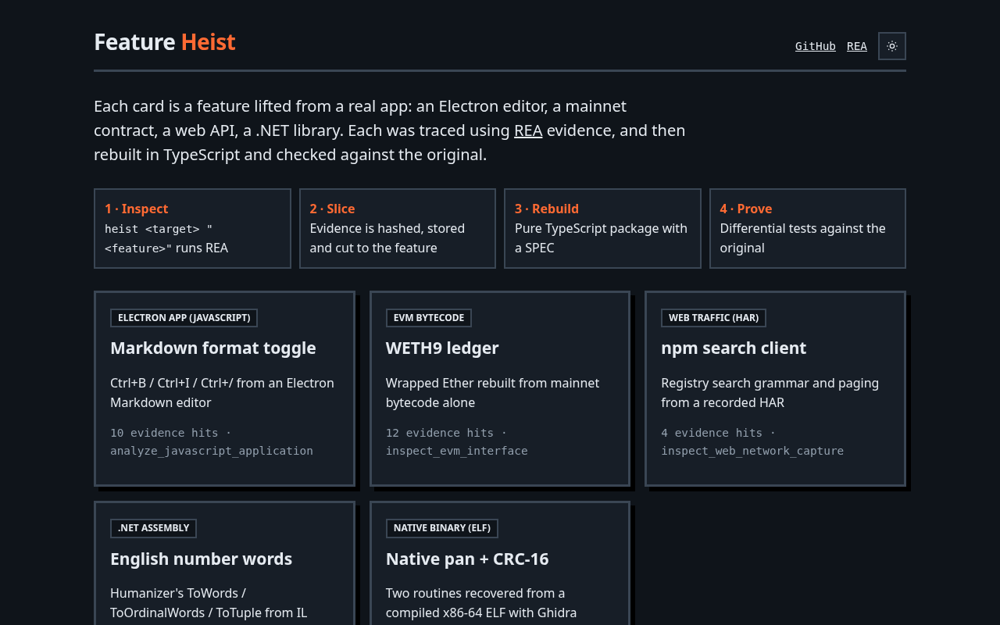
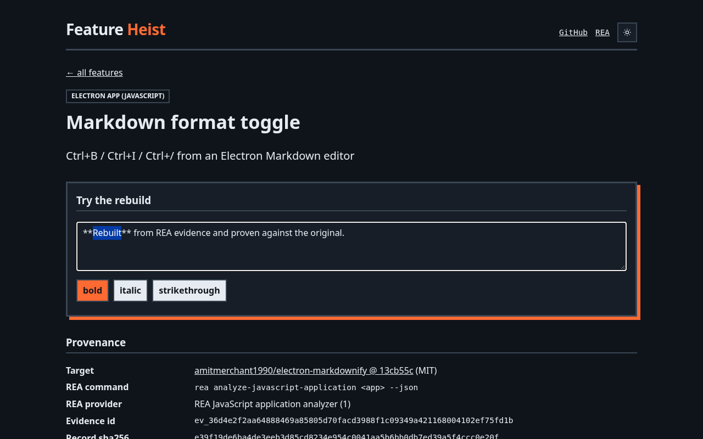
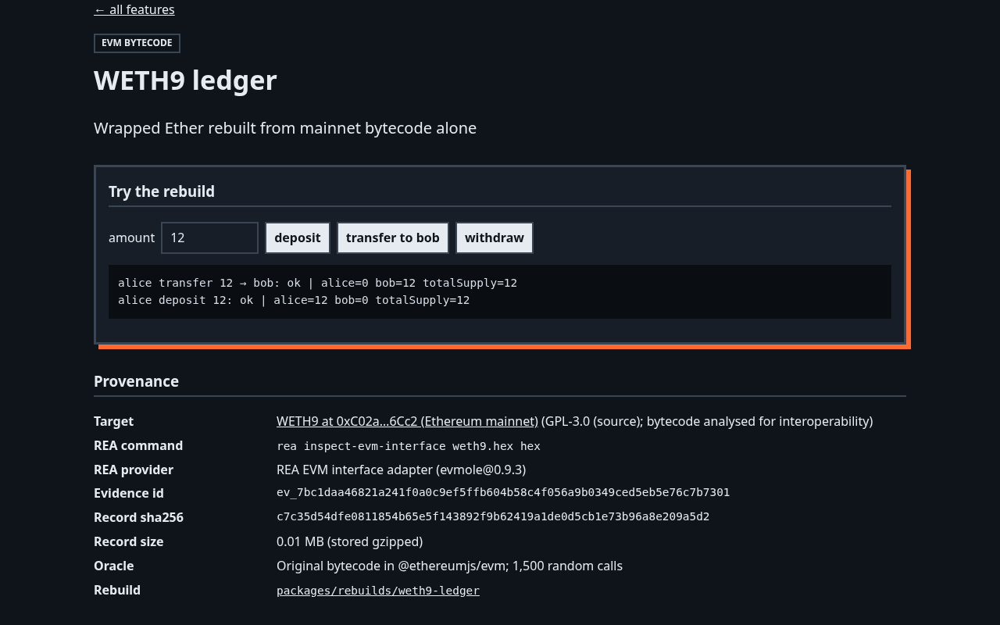
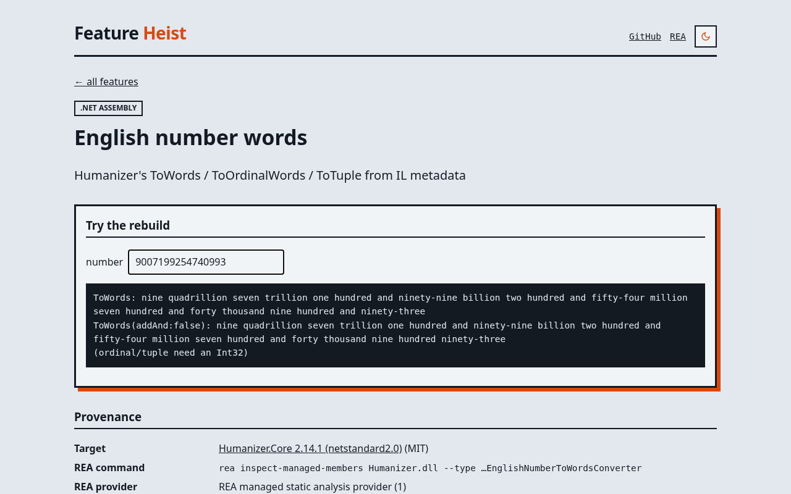
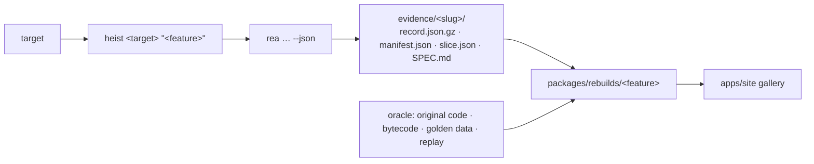

<div align="center">

# Feature Heist

### See a feature you like. Get the evidence. Ship a tested rebuild.

[](https://feature-heist.vercel.app)
[](https://github.com/devtechedge/feature-heist/actions/workflows/ci.yml)


</div>

Feature Heist turns [REA (Reverse Engineer Anything)](https://github.com/morluto/rea) output into **clean-room TypeScript rebuilds that are checked against the original**. One command captures REA evidence for a target. The evidence is hashed and stored, cut down to the feature you care about, turned into a spec, rebuilt as a pure package, and tested against an oracle built from the original.

| | Feature | Target type | REA command | Proof |
|---|---|---|---|---|
| 📝 | [Markdown format toggle](docs/features/markdown-toggle-format.md) | **Electron app** (electron-markdownify, MIT) | `analyze-javascript-application` | 5,000-case differential vs the original `format.js` in a VM |
| 🪙 | [WETH9 ledger](docs/features/weth9-ledger.md) | **EVM bytecode** (mainnet WETH9) | `inspect-evm-interface` | 1,500-call differential vs the original bytecode in `@ethereumjs/evm` |
| 🔎 | [npm search client](docs/features/npm-search-client.md) | **Web traffic** (HAR of registry.npmjs.org) | `inspect-web-network-capture` | Byte-exact URL round-trips + HAR replay |
| 🔢 | [English number words](docs/features/english-number-words.md) | **.NET assembly** (Humanizer 2.14.1, MIT) | `inspect-managed-members` | 4,830 golden rows from the real library, regenerated in CI |
| ⚙️ | [Native pan + CRC-16](docs/features/native-pan-crc.md) | **Native ELF** (own MIT C target, gcc -O2) | `function --provider ghidra` | 25,000-case differential vs the compiled binary, incl. 32-bit overflow |

## Live Demo

**[feature-heist.vercel.app](https://feature-heist.vercel.app)**

> The gallery is a static site. Every demo runs the rebuilt TypeScript package in your browser, and the provenance tables come from the stored REA evidence. Nothing runs server-side, and the npm demo only builds the request URL; the link opens the live registry response.

## Screenshots

| Gallery | Markdown toggle demo |
|---|---|
|  |  |
| **WETH9 demo and provenance** | **Number words, light theme** |
|  |  |

Every rebuild also has an `evidence.test.ts`. It loads the stored REA record, verifies its SHA-256, and checks that the vendored fixture is the *same bytes* REA analysed.

## How it works



1. **Inspect.** `heist` picks the REA command for the target type: a JS/Electron directory or `.asar`, `.har`/`.saz`, EVM `.hex`/`.bin`, `.dll`/`.exe`, or a native ELF/PE/Mach-O function through Ghidra. It streams REA's JSON to disk (one record here is 106 MB) and shows REA's progress.
2. **Store and slice.** `@heist/evidence` validates the record, gzips it, pins its SHA-256 in `manifest.json`, and writes a feature slice:
   - For JavaScript: semantic-graph nodes plus a caller → definition call chain.
   - For other targets: matching records, functions or members.
3. **Spec.** A `SPEC.md` scaffold lists the evidence hits. You complete it with behaviour, quirks and unknowns.
4. **Rebuild and prove.** Each rebuild is a pure TypeScript package, tested differentially against the original.

See [docs/architecture.md](docs/architecture.md) and [docs/evidence-schema.md](docs/evidence-schema.md).

## Stack

| Layer | Tech |
|---|---|
| Analysis | REA 6.7.0 CLI (JS graph, evmole EVM, HAR adapter, .NET metadata) |
| Monorepo | pnpm 9 workspaces, Turborepo, TypeScript strict, Node 22 |
| Tests | Vitest (unit, differential, golden), Playwright (e2e), @ethereumjs/evm, .NET 8 oracle, compiled ELF oracle |
| Native | Ghidra 12.1.4 headless + JDK 21 via REA (`--provider ghidra`) |
| Site | Next.js 15 static export, React 19, Vercel (redeploys on every push to main) |
| CI | GitHub Actions: build, typecheck, tests, e2e, oracle diff |

## Quick start

```bash
# Requirements: Node >= 22.19 (REA's requirement), pnpm 9
git clone https://github.com/devtechedge/feature-heist && cd feature-heist
pnpm install
npm install --global rea-agents        # provides the `rea` CLI

pnpm build
pnpm test                              # unit, differential, golden and evidence-provenance tests
pnpm e2e                               # Playwright against the static gallery (set CHROME_PATH to use a local Chrome)

pnpm heist doctor                      # rea doctor + rea capabilities
```

### Run your own heist

```bash
# Electron / JS app directory or .asar
pnpm heist ~/src/some-electron-app "search box ranking" --keywords rankResults,search

# Web: record a HAR, redact it, analyse it
node scripts/capture-har.mjs capture.har && node scripts/redact-har.mjs capture.har capture.redacted.har
pnpm heist capture.redacted.har "checkout api" --keywords /api/checkout

# EVM bytecode (hex from eth_getCode)
pnpm heist token.hex "token transfers" --keywords '*'

# .NET assembly, scoped to one type
pnpm heist Lib.dll "slug generator" --keywords Slug --rea-args "--type My.Namespace.Slugger"

# Native binary function (Ghidra 12 + JDK 21; see rea doctor --provider ghidra)
pnpm heist ./mybin "pan math" --procedure fh_pan --keywords fh_pan
```

Output goes to `evidence/<slug>/`. Complete `SPEC.md`, then scaffold the rebuild:

```bash
pnpm heist rebuild <evidence-slug> --name my-feature --title "My feature"
```

This creates:
- `packages/rebuilds/my-feature`, with a stub that has the SPEC behaviour in its doc comment
- a hash-verified evidence test and a test file with todo oracle cases
- a write-up
- a gallery entry

It never overwrites existing files. Next, implement the stub and replace the todos with an oracle-backed test.

[CONTRIBUTING.md](CONTRIBUTING.md) walks through it.

### Driving it from an agent

Run `npx rea-agents setup` to register REA's MCP server with Cursor, Claude Code, Codex and others. A good prompt:

> Run `pnpm heist <target> "<feature>"`, read `evidence/<slug>/slice.json` and the REA findings, complete SPEC.md with evidence locations and unknowns, implement `packages/rebuilds/<name>`, and add a differential test against an oracle until `pnpm test` passes.

## Repository layout

```
packages/evidence        REA record schema, validation, slicing, hashed gzip storage
packages/runner          `heist` CLI wrapping the rea CLI
packages/rebuilds/*      one package per rebuilt feature (+ fixtures, oracles, tests)
apps/site                Next.js static gallery with live demos of every rebuild
evidence/<slug>/         stored REA evidence, slices and SPECs
tools/humanizer-oracle   .NET program that emits golden outputs from the original Humanizer
scripts/                 HAR capture (Playwright) and redaction
docs/                    architecture, evidence schema, per-feature write-ups
```

## What was learned (quirks found in the originals)

- **Markdownify**: fully selecting `**hi**` and pressing Ctrl+B produces `**h****i**`. The marker-peeling loop re-tests the *original* selection text on every pass. The rebuild reproduces this, and the test pins it.
- **WETH9**: `name`, `symbol` and `decimals` come from storage initialisers, not runtime code. Runtime code alone answers `decimals() = 0`. The harness seeds storage slots 0–2 with the exact words verified with `eth_getStorageAt`.
- **pancrc (native)**: Ghidra types `fh_crc16` as returning a 32-bit `uint` seeded with `0xffffffff`. The 16-bit truncation only happens at the call site.
- **Humanizer**: `ToWords(addAnd: false)` only drops the *last* "and", because the recursive call uses default arguments (visible in REA's call edges). Negative ordinals come out cardinal (`minus five`).

## Limitations

- REA 6.7.0's `rea evidence-export` validates MCP session *bundles*. One-shot CLI commands emit single records, so Feature Heist stores the record itself with its own SHA-256 manifest.
- Native support is one function dossier per run (`--procedure`). Whole-program `rea analyze` snapshots aren't stored yet.
- Rebuilds reproduce **behaviour**, not code. Third-party artifacts are kept only as licensed oracles; see [THIRD_PARTY_NOTICES.md](THIRD_PARTY_NOTICES.md).

## Roadmap

- Import MCP session bundles through `rea evidence-export`, and compare evidence across target versions with `rea compare`.
- Store native `rea analyze` snapshots, and add Hopper and IDA provider runs to the native example.
- Let `heist rebuild` generate oracle harness templates for each target type (VM sandbox, EVM, replay, golden).

## Responsible use

Only analyse software you are allowed to analyse. See [DISCLAIMER.md](DISCLAIMER.md).

## License

[MIT](LICENSE) © Devayan Mandal. Third-party fixtures keep their own licenses.
