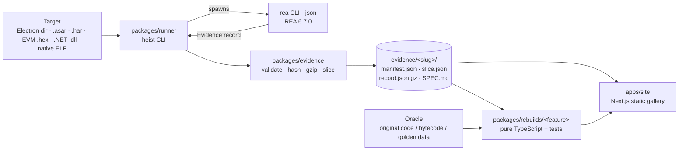

# Architecture

Feature Heist is a pnpm + Turborepo monorepo. Each folder does one job:

| Package | Role |
|---|---|
| `packages/evidence` | Types and validation for REA Evidence records, feature slicing (JS semantic graph or generic array walk), gzip storage with a SHA-256 manifest, and verified loading. |
| `packages/runner` | `heist <target> "<feature>"` and `heist rebuild <slug> --name <pkg>`. Picks the REA command for the target type, streams stdout to disk (records can be over 100 MB), shows REA progress, stores the evidence and writes a `SPEC.md` scaffold. `heist doctor` runs `rea doctor` and `rea capabilities`. |
| `packages/rebuilds/*` | One package per feature, with no runtime dependency on REA or the target. Tests compare against an oracle. |
| `apps/site` | Static Next.js gallery: provenance, evidence hits, call chains, SPECs and live demos of each rebuild. |
| `tools/humanizer-oracle` | .NET console app that runs the original Humanizer to produce golden outputs. |
| `scripts/` | HAR capture (Playwright) and e-mail redaction. |

## Target routing (`planCommand`)

| Target | REA command |
|---|---|
| directory or `.asar` | `analyze-javascript-application <path> --json` |
| `.har` / `.saz` | `inspect-web-network-capture <path> har|saz` |
| `.hex` / `.evm` / `.bin` | `inspect-evm-interface <path> hex|raw` |
| `.dll` / `.exe` | `inspect-managed-members <path>` (add `--rea-args "--type Ns.Type"`) |
| ELF / PE / Mach-O (by magic bytes) + `--procedure` | `function <path> <procedure> --provider ghidra` (`--provider` overrides) |

## Why one Evidence record and not `rea evidence-export`?

In REA 6.7.0, `rea evidence-export` validates *session bundles* (`records` + `manifest`), which come from the MCP `export_evidence_bundle` tool. A one-shot CLI command produces a single Evidence record, so `@heist/evidence` stores that record as-is (gzipped) and pins it with its own SHA-256 in `manifest.json`. `load()` refuses a record whose hash doesn't match. Bundle support is on the roadmap.

## Oracles: how each rebuild is checked

| Feature | Oracle |
|---|---|
| Markdown toggle | The original `format.js` (vendored at the hash REA reported) runs in a Node `vm` against a minimal CodeMirror stand-in. 5,000 random documents and selections are compared to the rebuild. |
| WETH9 | The original mainnet runtime bytecode runs in `@ethereumjs/evm`. 1,500 random calls are compared on revert, return data, event count and ETH held. |
| npm search | Byte-exact URL round-trips for every recorded request, plus HAR replay of the recorded responses. |
| Native pan + CRC | The compiled ELF in batch mode: 20,000 pan cases (including 32-bit overflow) and 5,000 CRC strings. |
| Number words | 4,830 golden rows produced by the real Humanizer 2.14.1. CI regenerates them and diffs. |

## Scaffolding (`heist rebuild`)

`scaffoldRebuild()` loads hash-verified evidence and copies the bullet points from the `## Behaviour` section of `SPEC.md` into the generated doc comment. It creates:
- package.json and tsconfig
- a stub implementation
- an evidence test pinned to the `evidence_id`
- a test file with todo oracle cases
- `docs/features/<name>.md`

It then adds an entry before the closing `];` of the gallery's `FEATURES` array. It refuses to overwrite files, and it skips the site entry when the slug is already listed.

## Deployment

The site is a static export. Vercel is connected to the repository, and `vercel.json` builds `@heist/site` and its workspace dependencies with Turborepo, then serves `apps/site/out` on every push to `main`.
